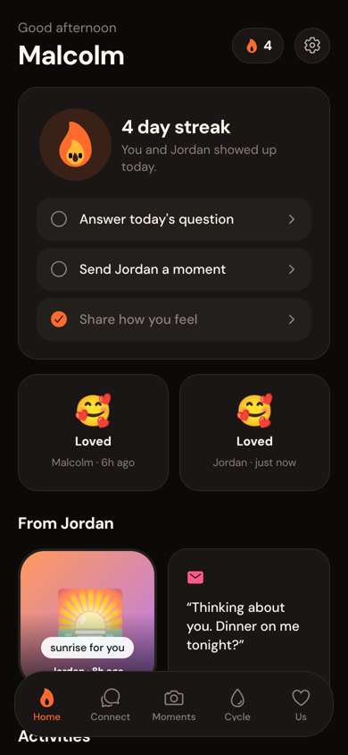
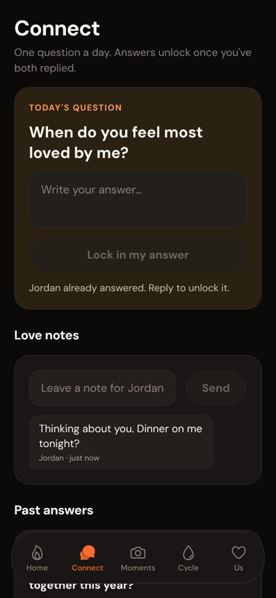
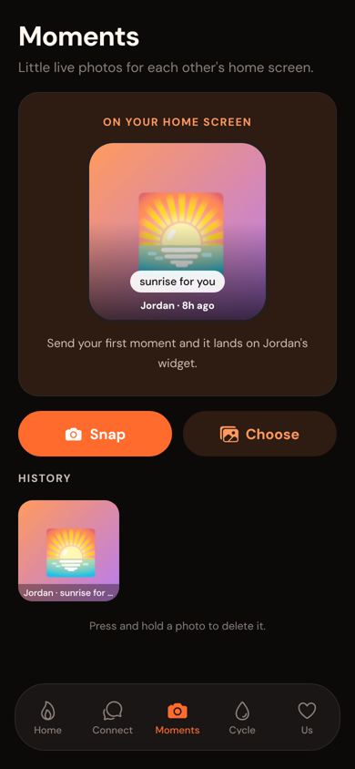
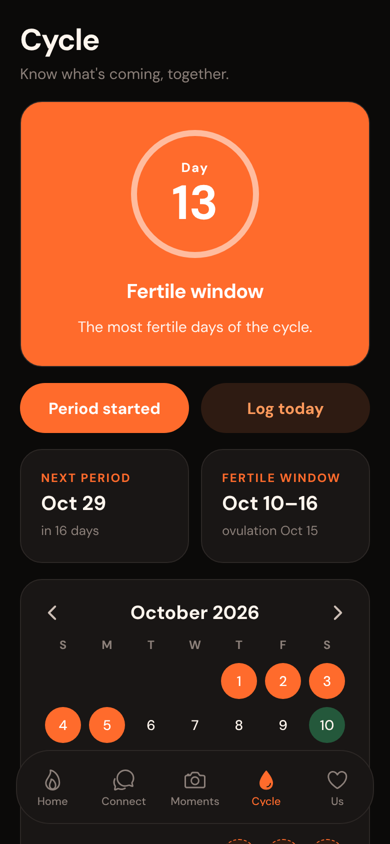
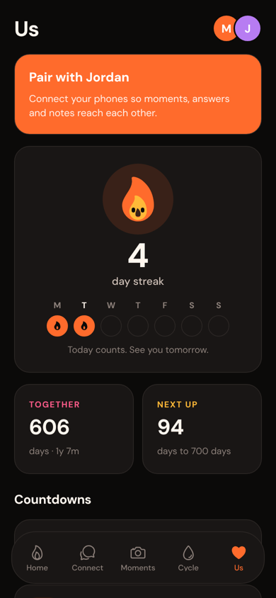

# Pure Love

One cosy app for couples that brings together three things people usually juggle in separate apps:

- **Home** – your shared streak with a little flame that stays lit while you keep showing up, today's checklist, both moods, the latest photo and note from your partner, and a grid of things to do together.
- **Connect** – a daily question whose answers unlock only once you've both replied, love notes, and every past answer.
- **Moments** – snap or pick a photo, add a caption and send it to your partner. The newest one shows on a square photo tile, the same tile a home screen widget will show.
- **Cycle** – log period days, flow, symptoms and mood. The app predicts the next period, fertile window and ovulation from your own history, and you choose whether your partner sees your phase.
- **Us** – the couple dashboard: streak week, days together, countdowns to milestones and anniversaries, pairing and a shared date-idea list.

The look follows the Candle couples app: a dark, near-black interface lit by a bright flame orange, colourful activity cards, rounded DM Sans type and a floating tab bar. All code, artwork and copy here is original.

| Home | Connect | Moments | Cycle | Us |
| --- | --- | --- | --- | --- |
|  |  |  |  |  |

## Running it

Built with Expo (SDK 57), Expo Router and TypeScript.

```bash
npm install
npx expo start        # then press i / a / w, or scan the QR code with Expo Go
npm run typecheck
npm test              # cycle, date, streak and sync tests (node:test)
```

## Syncing two phones

Each phone keeps everything locally and syncs through a small server you run yourself (`server/`, Node and SQLite with no other dependencies). It's meant for an always-on computer at home, reached privately over [Tailscale](https://tailscale.com), so nothing goes through a third-party cloud.

**1. Start the server** on the always-on machine (needs Docker and Tailscale):

```bash
git clone https://github.com/s-rakim/pure-love-train && cd pure-love-train
docker compose up -d
curl http://localhost:8787/health   # {"ok":true}
```

Data lives in the `pure-love-data` Docker volume (the database plus photos). Back it up with
`docker run --rm -v pure-love-train_pure-love-data:/data -v "$PWD":/backup alpine tar czf /backup/pure-love-backup.tgz /data`.

**2. Pair the phones.** Both phones need Tailscale on, signed in to the same tailnet.

- On the first phone, open **Settings → Sync**, enter the machine's Tailscale address with the port (for example `http://100.101.102.103:8787` or `http://my-server:8787` with MagicDNS) and tap **Create our space**.
- A six-letter code appears. On the second phone, enter the same address and the code, then tap **Join**.

From then on the app syncs on open, every 15 seconds while it's open, and shortly after each change.

What syncs: names, moods, daily answers, love notes, moment photos, date ideas and the anniversary date. For the cycle, only the period dates and predictions are shared, and only while **Share with (partner)** is on in the Cycle tab; logs, symptoms and notes never leave the phone. Each partner can only change their own entries.

The app talks plain HTTP, which is fine inside a tailnet since Tailscale encrypts the traffic. If you'd rather use HTTPS, run `tailscale serve --bg 8787` on the server and use the `https://<machine>.<tailnet>.ts.net` address instead.

To run the server without Docker: `cd server && node src/index.ts` (Node 22.18 or newer; set `PORT` and `DATA_DIR` if you like). Server tests: `cd server && npm test`.

Without a server you can still preview the shared features with **Settings → Preview with a demo partner**.

Next steps:

1. Real home screen widgets: an iOS WidgetKit extension (via a config plugin such as `@bacons/apple-targets`) and an Android widget (`react-native-android-widget`), both reading the latest moment from a shared app group. These need a development build rather than Expo Go.
2. Push notifications when your partner sends a moment or answers the daily question.

## Project layout

```
src/app/            screens (Expo Router)
  (tabs)/           Home, Connect, Moments, Cycle, Us
  log/[date].tsx    day log modal
  onboarding.tsx, settings.tsx
src/components/     shared UI, flame, calendar, photo widget, question card, sync
src/lib/            store, cycle maths, dates, questions, photo helpers, sync
src/theme/          colours, fonts, spacing
server/             sync server (Node + SQLite), Dockerfile
docker-compose.yml  runs the server with a persistent volume
```

Cycle predictions are estimates and are not contraception or medical advice.
