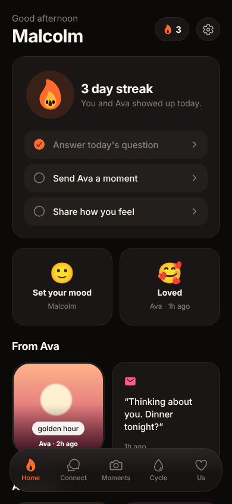
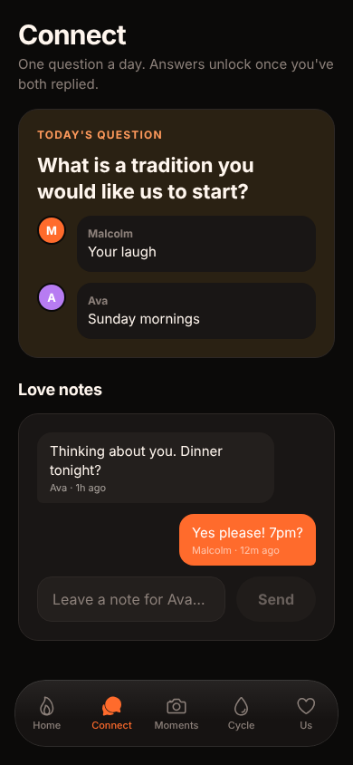
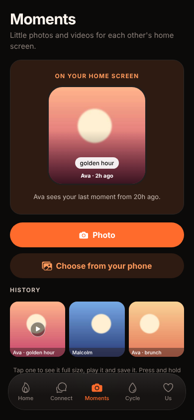
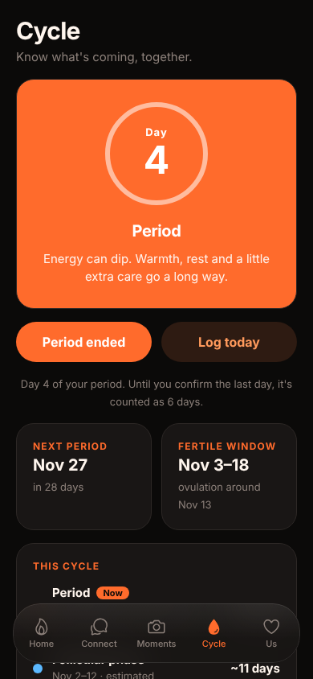
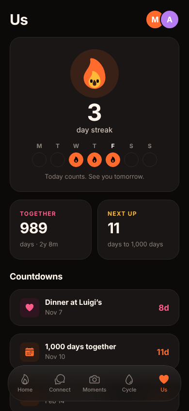

# You&I💞

(Formerly Pure Love.) One cosy app for couples that brings together three things people usually juggle in separate apps:

- **Home** – your shared streak with a little flame that stays lit while you keep showing up (it resets after a missed day, with two free restores a month), a celebration card on anniversaries, birthdays and every 100 days together, today's checklist, both moods, the latest moment and note from your partner, and a grid of things to do together: send a hug (a one-tap love note), **This or that** (pick a side of quick pairs, then see where you match; 50 new pairs a day for two years, and any you skip wait for the next day), **Open when…** letters that stay sealed until your partner chooses to open them, love coupons your partner can redeem, a date night spin that picks from your date ideas, and a countdown to your next date.
- **Connect** – a daily question (738 of them on your server, so none repeats for two years) whose answers unlock only once you've both replied, love notes that read like a chat (newest at the bottom), and every past answer.
- **Moments** – take or pick a photo, or a video of up to 30 seconds, add a caption and send it to your partner. Their newest moment shows on an Android home screen widget (a still frame for a video), and yours on theirs. Tap any moment in History to see it full size or play the video, swipe through the rest and save it to your phone. History holds both your moments and your partner's. Tick **View once** for something special: it never shows on the widget, and your partner can open it once from History.
- **Cycle** – tap **Period started** and **Period ended** to confirm the exact first and last day (today, yesterday or any day on the calendar), and fix or add any past period. **This cycle** lists each stage (period, follicular, ovulation, luteal) with its dates and length, and **Your cycles** shows how long each past cycle and period lasted. Irregular cycles get a window for the next period and a wider fertile window, worked out from your shortest and longest recent cycles. Log flow, symptoms and mood, and choose whether your partner sees your phase.
- **Us** – the couple dashboard: streak week, days together, countdowns to your next date, milestones and anniversaries, pairing and a shared date-idea list with three fresh ideas every two weeks.

The look follows the Candle couples app: a dark, near-black interface lit by a bright flame orange, colourful activity cards and a floating, frosted-glass tab bar that sits above the phone's navigation buttons. There's also a soft blush-pink light mode. Text uses the phone's own font, so the app matches the rest of the phone; DM Sans is still available. The app follows the phone's light or dark setting, or you can pick one in **Settings → Appearance**, along with the font. All code, artwork and copy here is original.

| Home | Connect | Moments | Cycle | Us |
| --- | --- | --- | --- | --- |
|  |  |  |  |  |

**Keeping it running yourself:** [docs/GUIDE.md](docs/GUIDE.md) explains how everything works, how to ship a fix (over the air or a new APK), and what to try when something breaks.

## Running it

Built with Expo (SDK 57), Expo Router and TypeScript.

```bash
npm install
npx expo start        # then press i / a / w, or scan the QR code with Expo Go
npm run typecheck
npm test              # cycle, date, question, streak and sync tests (node:test)
```

## Syncing two phones

Each phone keeps everything locally and syncs through a small server you run yourself (`server/`, Node and SQLite with no other dependencies). It's meant for an always-on computer at home, reached privately over [Tailscale](https://tailscale.com), so nothing goes through a third-party cloud.

**1. Start the server** on the always-on machine (needs Docker and Tailscale):

```bash
git clone https://github.com/s-rakim/pure-love-train && cd pure-love-train
docker compose up -d
curl http://localhost:8787/health   # {"ok":true}
tailscale serve --bg 8787           # shares it on your tailnet at https://<machine>.<tailnet>.ts.net
```

The server only listens on the machine itself, so nothing on your home Wi-Fi or the internet can reach it; `tailscale serve` passes it on to your tailnet over HTTPS. If you'd rather keep a plain `http://` Tailscale address, put `BIND_ADDRESS=<the machine's Tailscale IP>` (from `tailscale ip -4`) in a `.env` file next to `docker-compose.yml` and run `docker compose up -d` again. Don't set it to `0.0.0.0`. If other people or devices share your tailnet, add a [Tailscale ACL](https://tailscale.com/kb/1018/acls) so only your two phones can reach the server.

The server holds up to 10 spaces with 5 GB of photos and videos each. Change that with `MAX_SPACES` and `STORAGE_LIMIT_GB` in the same `.env` file.

Data lives in the `pure-love-data` Docker volume (the database plus photos). Back it up with
`docker run --rm -v pure-love-train_pure-love-data:/data -v "$PWD":/backup alpine tar czf /backup/pure-love-backup.tgz /data`.
It isn't encrypted on disk, so turn on your computer's disk encryption (BitLocker, FileVault or LUKS) and keep any backup copies somewhere only you can open.

**2. Pair the phones.** Both phones need Tailscale on, signed in to the same tailnet.

- On the first phone, open **Settings → Sync**, enter the server's address (for example `https://my-server.tail1234.ts.net`, or `http://100.101.102.103:8787` if you set `BIND_ADDRESS`) and tap **Create our space**.
- A six-letter code appears. On the second phone, enter the same address and the code, then tap **Join**. A code that isn't used within a day is replaced by a new one.

From then on the app syncs on open, every 15 seconds while it's open, and shortly after each change.

What syncs: names, moods, daily answers, love notes, moment photos and videos, This or that picks, Open when… letters, date ideas, love coupons, the next date and the anniversary date. For the cycle, only the period dates and predictions are shared, and only while **Share with (partner)** is on in the Cycle tab; logs, symptoms and notes stay on the phone (and in your own private backup if you sign in with Google). Each partner can only change their own entries, and only the writer of a letter or coupon can change its words.

Plain `http://` is fine inside a tailnet since Tailscale encrypts the traffic; the app warns you if you enter an `http://` address outside it.

**Signing out and deleting.** **Disconnect** signs this phone out on the server. **Sign out my other phones** cuts off any other phone signed in as you, like a lost one. **Erase all data** also deletes everything you shared from the server: your moments (with their photos and videos), notes, answers, your Google link and your backup. Deleting a moment deletes its photo or video from the server too, and phones that haven't synced for 180 days are signed out.

**Updating the server.** When a new version of the app needs a newer server (1.5.0 does, for videos, This or that and letters; the security update after it does, for signing out and deleting), update it on the server machine with `git pull && docker compose up -d --build`. Your data stays in the volume. Until then the app keeps those changes and sends them once the server is updated.

To run the server without Docker: `cd server && node src/index.ts` (Node 22.18 or newer; set `PORT` and `DATA_DIR` if you like). Server tests: `cd server && npm test`.

Without a server you can still preview the shared features with **Settings → Preview with a demo partner**.

### The home screen widget (Android)

Long-press the home screen, tap **Widgets** and pick **You&I💞**, or use **Add the widget to your home screen** in the Moments tab. It shows your partner's newest moment, or a still frame from it if it's a video. It updates as soon as the app syncs, and every 30 minutes or so it checks the server by itself, so a new moment turns up even if you don't open the app. Tapping it opens that moment in the app, where a video plays. To keep it private, pick **Settings → Widget → Keep it private**: the widget then only says a new moment arrived.

### Moving to a new phone (Sign in with Google)

Signing in with Google ties your place in the space to your Google account and keeps a private backup on your server of the things that otherwise only live on the phone (names, anniversary, cycle logs and the chosen look). On a new phone, tap **Restore with Google** on the welcome screen and everything comes back, including your moments, notes and answers.

It needs a Google OAuth client, which you set up once:

1. In [Google Cloud Console](https://console.cloud.google.com), create a project and set up the **OAuth consent screen** (External). While it's in testing, add both of your Gmail addresses as test users.
2. Under **Credentials → Create credentials → OAuth client ID**, create a **Web application** client. Copy its client ID.
3. Create a second OAuth client ID of type **Android** with package name `com.rakimbuilds.youandi` and the **SHA-1 fingerprint** of the app's signing key, which is on expo.dev under **Project → Credentials → Android**.
4. On the server machine, put `GOOGLE_CLIENT_ID=<the web client ID>` in a `.env` file next to `docker-compose.yml` and run `docker compose up -d --build`.
5. In the app, open **Settings → Your account → Sign in with Google**.

The app asks the server for the client ID, so nothing needs rebuilding when you set this up.

Next steps:

1. An iOS home screen widget (a WidgetKit extension via a config plugin such as `@bacons/apple-targets`).
2. Instant push notifications through Firebase. Today the app checks your server in the background every 15 to 30 minutes and posts local notifications.

## Project layout

```
src/app/            screens (Expo Router)
  (tabs)/           Home, Connect, Moments, Cycle, Us
  log/[date].tsx    day log modal
  moment/[id].tsx   full-size photo and video viewer
  once/[id].tsx     view-once moments
  onboarding.tsx, settings.tsx, coupons.tsx, letters.tsx, this-or-that.tsx
src/components/     shared UI, flame, calendar, period and next-date sheets, photo widget, video player, question card, sync, theme
src/lib/            store, cycle maths, dates, questions, streak, celebrations, photo and video helpers, sync, notifications, Google sign-in
src/theme/          light and dark palettes, fonts, spacing
src/widget/         the Android home screen widget and its background refresh
index.ts            app entry; registers the widget
server/             sync server (Node + SQLite), Dockerfile; daily questions and date ideas in server/src/content/
docs/GUIDE.md       how it all works and how to fix it
docker-compose.yml  runs the server with a persistent volume
```

Cycle predictions are estimates and are not contraception or medical advice.
