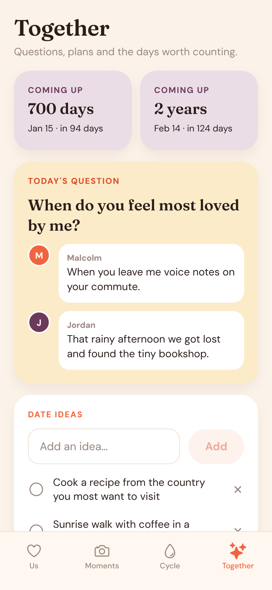

# Pure Love

One cosy app for couples that brings together three things people usually juggle in separate apps:

- **Us** – a days-together counter, both partners' moods, a daily question whose answers unlock only once you've both replied, and love notes.
- **Moments** – snap or pick a photo, add a caption and send it to your partner. The newest one shows on a square photo tile, the same tile a home screen widget will show.
- **Cycle** – log period days, flow, symptoms and mood. The app predicts the next period, fertile window and ovulation from your own history, and you choose whether your partner sees your phase.
- **Together** – upcoming milestones (every 100 days, anniversaries), past answers, a shared date-idea list and the love-note history.

The look is warm and soft: cream paper, flame orange, blush and plum, Fraunces headings and DM Sans body text. All code and copy here is original.

| Us | Moments | Cycle | Together |
| --- | --- | --- | --- |
|  |  |  |  |

## Running it

Built with Expo (SDK 57), Expo Router and TypeScript.

```bash
npm install
npx expo start        # then press i / a / w, or scan the QR code with Expo Go
npm run typecheck
npm test              # cycle prediction and date tests (node:test)
```

## What's local for now

Everything is stored on the device (AsyncStorage, photos copied into the app's documents folder). Two phones don't sync yet, so the partner's side can be previewed with **Settings → Preview with a demo partner**. The invite code on the settings screen is a placeholder for pairing.

Next steps:

1. A backend for pairing and sync (for example Supabase or Firebase): accounts, the invite code, and realtime updates for moments, answers, moods and notes.
2. Real home screen widgets: an iOS WidgetKit extension (via a config plugin such as `@bacons/apple-targets`) and an Android widget (`react-native-android-widget`), both reading the latest moment from a shared app group. These need a development build rather than Expo Go.
3. Push notifications when your partner sends a moment or answers the daily question.

## Project layout

```
src/app/            screens (Expo Router)
  (tabs)/           Us, Moments, Cycle, Together
  log/[date].tsx    day log modal
  onboarding.tsx, settings.tsx
src/components/     shared UI, calendar, photo widget, question card
src/lib/            store, cycle maths, dates, questions, photo helpers
src/theme/          colours, fonts, spacing
```

Cycle predictions are estimates and are not contraception or medical advice.
